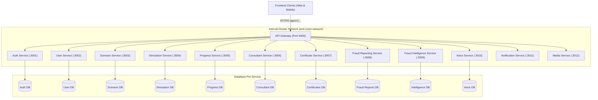

# Архитектурная документация (ARCHITECTURE.md)
## Платформа Anti-Scam Uzbekistan — Микросервисная архитектура

---

## 1. Архитектурное видение

Платформа **Anti-Scam Uzbekistan** спроектирована как полноценная **микросервисная архитектура (Microservice Architecture)**, готовая к эксплуатации в контейнеризованной среде (Docker Compose для локальной разработки и начального деплоя, с нулевыми изменениями переносимая в Kubernetes).

Все запросы клиентских приложений проходят исключительно через **API Gateway**, являющийся единой точкой входа.



---

## 2. API Gateway

### Обязанности
- **Routing & Reverse Proxy**: прозрачная переадресация запросов на внутренние сервисы.
- **API Versioning**: все публичные эндпоинты имеют префикс `/api/v1/...`.
- **Security & Rate Limiting**: защита микросервисов от злоупотреблений и флуда.
- **Request Tracing**: сквозная генерация и проброс `x-request-id` и `x-correlation-id`.
- **CORS & Headers**: стандартизированная обработка кросс-доменных заголовков.
- **Error Normalization**: преобразование ошибок в формат:
  ```json
  {
    "error": {
      "code": "ERROR_CODE",
      "message": "Human readable description",
      "requestId": "uuid"
    }
  }
  ```
- **Health Aggregation**: эндпоинт `/health` проводит параллельный опрос состояния всех микросервисов.
- **OpenAPI Documentation**: агрегированная спецификация API доступна по адресу `/api/docs`.

---

## 3. Каталог микросервисов

### 3.1. Auth Service (`:3001`)
- **Зона ответственности**: регистрация, аутентификация, выдача авторизационных токенов, управление ролями (`USER`, `CONSULTANT`, `ADMIN`, `ANALYST`, `SUPER_ADMIN`), сессиями.
- **Хранилище**: `auth.db` (или схема `antiscam_auth`). Секреты паролей и хеши принадлежат исключительно этому сервису.

### 3.2. User Service (`:3002`)
- **Зона ответственности**: профили пользователей, локализация (ru/uz), персональные настройки, агрегация публичных данных профиля.
- **Хранилище**: `users.db`. Не содержит паролей или секретов аутентификации.

### 3.3. Scenario Service (`:3003`)
- **Зона ответственности**: мастер-источник учебных сценариев (все 35 data-driven сценариев платформы с банками РУз, фишингом, дроп-картами, вредоносными APK и др.).
- **Хранилище**: `scenarios.db`.

### 3.4. Simulation Service (`:3004`)
- **Зона ответственности**: runtime-сессии симуляций, **авторитетный серверный таймер** (`expiresAt`), фиксация решений пользователя, расчёт последствий, детекция попыток фальсификации со стороны фронтенда.
- **Хранилище**: `simulations.db`.

### 3.5. Progress Service (`:3005`)
- **Зона ответственности**: расчёт виртуального баланса (начальный: 10 000 000 сум), учёт предотвращённого и причинённого ущерба, уровни квалификации (Level 1: Базовый, Level 2: Защитник, Level 3: Консультант).
- **Хранилище**: `progress.db`.

### 3.6. Consultant Service (`:3006`)
- **Зона ответственности**: квалификационные испытания 3-го уровня (оценка развёрнутых ответов по структуре: "Что произошло", "Признаки атаки", "Необходимые действия"), реферальные коды и учёт вовлечения окружения.
- **Хранилище**: `consultant.db`.

### 3.7. Certificate Service (`:3007`)
- **Зона ответственности**: выпуск цифровых сертификатов, генерация 64-символьного криптографического хеша SHA-256, публичный верификационный реестр (`GET /api/v1/certificates/:id/verify`).
- **Хранилище**: `certificates.db`.

### 3.8. Fraud Reporting Service (`:3008`)
- **Зона ответственности**: приём обращений граждан о мошенничестве, валидация номеров телефонов Узбекистана (`+998...`), реквизитов карт, ссылок и скриншотов. Внутренняя аналитика скрыта от обычных пользователей.
- **Хранилище**: `fraud_reports.db`.

### 3.9. Fraud Intelligence Service (`:3009`)
- **Зона ответственности**: извлечение сущностей, детерминированная корреляция (связывание телефон $\to$ Telegram $\to$ URL $\to$ карта $\to$ кластер), расчёт уровня угрозы (`threatLevel`) и показателя уверенности (`confidenceScore`).
- **Хранилище**: `intelligence.db`.

### 3.10. Voice Service (`:3010`)
- **Зона ответственности**: симулятор телефонного мошенничества (вишинг) с абстракцией провайдера речи (`VoiceProvider`).
- **Хранилище**: `voice.db`.

### 3.11. Notification Service (`:3011`)
- **Зона ответственности**: диспетчеризация уведомлений (Email, Telegram Bot, SMS, Web Push).

### 3.12. Media Service (`:3012`)
- **Зона ответственности**: загрузка и раздача бинарных вложений (скриншоты, артефакты сценариев) с абстракцией над S3 / MinIO / Local Disk.

---

## 4. Принцип изоляции данных (Database-per-service)

Каждый сервис взаимодействует **исключительно** со своей схемой или базой данных.
Прямые межсервисные SQL-запросы категорически запрещены:
- Обмен данными между сервисами выполняется строго через внутренний REST API с передачей сервисного токена `x-service-token` или через события брокера сообщений.
- Подготовлен скрипт инициализации PostgreSQL: `infrastructure/postgres/init-databases.sql`.
- Для локальной разработки без Docker каждый сервис автономно использует собственную локальную SQLite БД (`./data/<service>/`).

---

## 5. Сетевая безопасность и Docker Network

- Создана внутренняя виртуальная сеть Docker `anti-scam-network`.
- **Публично опубликован только порт API Gateway (`5000:5000`)**.
- Порты внутренних микросервисов (`3001`–`3012`) не пробрасываются наружу на хост-машину, предотвращая прямой несанкционированный доступ.
