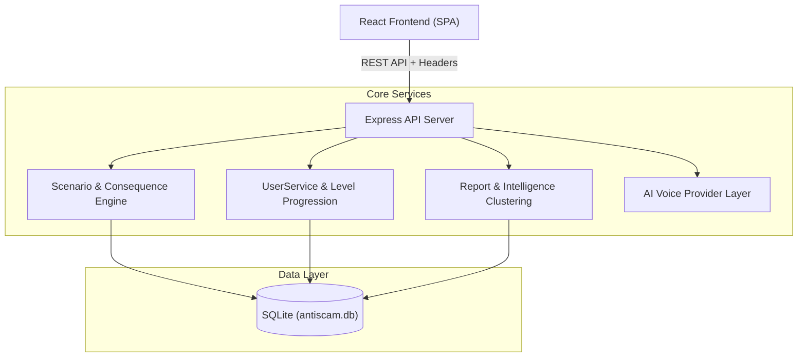

# Архитектурная документация (ARCHITECTURE.md)

## 1. Архитектурное видение

Платформа **Anti-Scam Uzbekistan** спроектирована как высокопроизводительный модульный монолит, разделяющий бизнес-логику симуляции, обработку последствий и реалистичный рендеринг интерфейсов.



---

## 2. Основные компоненты и сервисы

### 2.1. Scenario Engine & Consequence Engine
- Сценарии полностью отделены от разметки фронтенда (**data-driven**).
- Каждый сценарий содержит:
  - `stages`: тайминги и психологические фразы давления.
  - `interface`: тип отображаемого generic-интерфейса (`telegram`, `sms`, `email`, `browser`, `banking`, `social`, `delivery`, `call`).
  - `availableActions`: варианты действий пользователя.
  - `consequences`: детерминированные последствия (финансовый ущерб, компрометация устройства, перехват OTP).
  - `feedback`: подробный педагогический разбор уловок и золотых правил кибербезопасности.

### 2.2. User Immunity Progression & Certificates
- **Уровень 1: Распознай (Basic)** — успешное распознавание первичных признаков атак в базовых каналах.
- **Уровень 2: Защити (Defender)** — выдерживание жесткого психологического давления и применение правильных алгоритмов верификации.
- **Уровень 3: Консультант (Consultant)** — решение кейсов окружения (помощь коллегам и семье при целевых атаках).
- Криптографически верифицируемый сертификат с хешем SHA-256 (`CERT-UZ-...`).

### 2.3. Rule-Based Fraud Intelligence (Scam Clusters)
- Модуль сообщений анализирует ключевые индикаторы компрометации (IoC):
  - Номера телефонов (`+998...`)
  - Telegram никнеймы и ID ботов (`@...`)
  - Целевые фишинговые URL и домены
  - Платёжные реквизиты (номера дроп-карт Humo/Uzcard)
- При совпадении двух и более индикаторов система связывает отчёты в **Scam Cluster** с расчётом показателя уверенности (`confidenceScore`).

### 2.4. AI Voice Provider Abstraction
```typescript
export interface VoiceProvider {
  name: string;
  initializeCall(scenarioId: string): Promise<VoiceCallState>;
  processReply(callId: string, replyId: string): Promise<{
    nextScript?: string;
    isCallEnded: boolean;
    consequenceId?: string;
    urgencyLevel: 'moderate' | 'high' | 'extreme';
  }>;
}
```
- Архитектура не зависит от конкретного внешнего вендора (ElevenLabs, OpenAI, Gemini Voice).
- Для локальной и офлайн-разработки используется встроенный `SimulationVoiceProvider`, взаимодействующий с клиентским Web Speech API.

---

## 3. Модель данных (SQLite Schema)

- `users`: пользователи, баланс (начальный 10 000 000 сум, текущий, симулированный ущерб), уровень иммунитета, количество приглашённых.
- `scenarios`: data-driven описание всех ситуаций в сериализованном виде.
- `scenario_sessions`: журнал прохождений с таймингами, выбранными действиями и результатом.
- `certificates`: цифровые сертификаты уровней Basic, Defender, Consultant с уникальными хешами.
- `fraud_reports`: входящие инциденты от граждан с полями индикаторов.
- `scam_clusters`: агрегированные мошеннические синдикаты и связанные индикаторы.

Схема нормализована и готова к прозрачной миграции на PostgreSQL при переходе в промышленную эксплуатацию.
